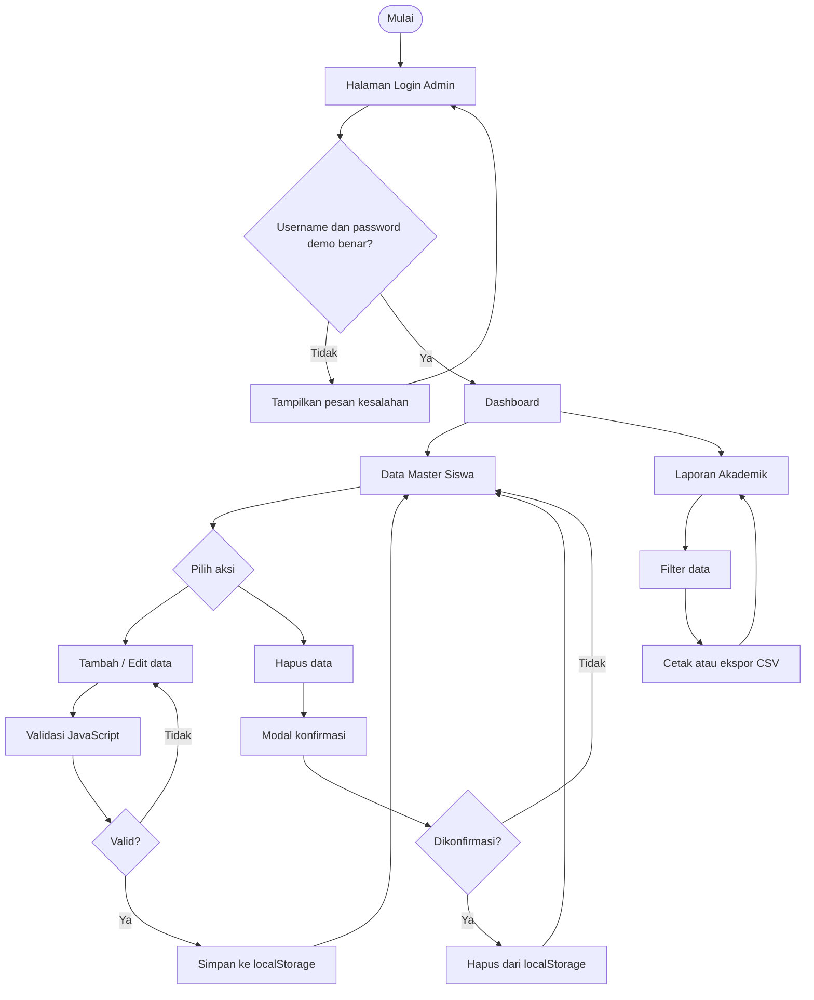
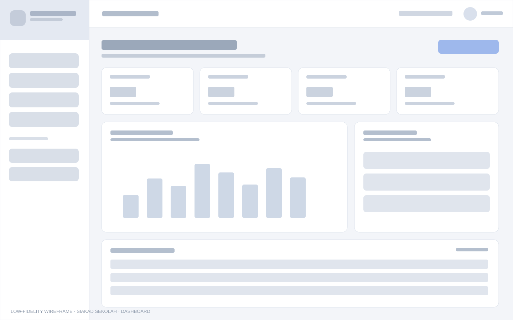
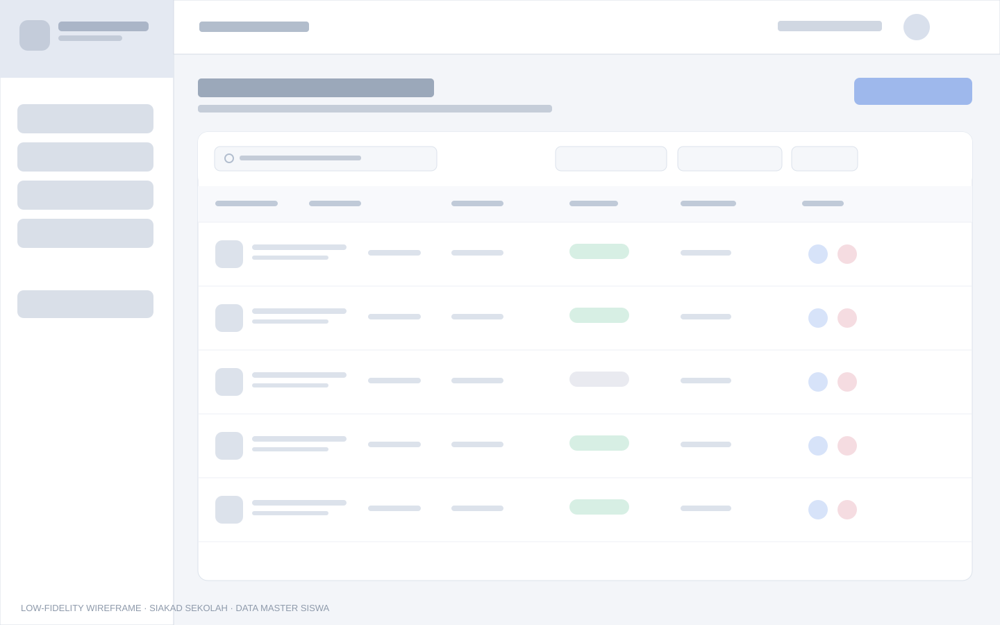
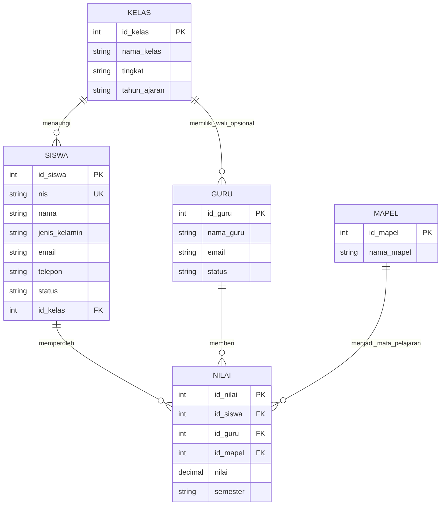

# PERANCANGAN — Admin Panel SIAKAD Sekolah

**Mata Kuliah:** Pemrograman Web 2 (Client-Side Programming)  
**Topik:** Sistem Informasi Akademik Sekolah (SIAKAD)  
**Arsitektur UI:** Material Design  
**Teknologi:** HTML5, CSS3, JavaScript, localStorage, Chart.js (CDN)

## 1. Tujuan aplikasi

Membangun antarmuka admin sekolah yang responsif untuk melihat ringkasan akademik, mengelola data master siswa, memasukkan/mengubah informasi siswa, dan menghasilkan laporan sederhana. Fokus tugas ini adalah arsitektur informasi, UI/UX, dan interaktivitas client-side. Proyek tidak menggunakan backend atau database server.

## 2. Pengguna dan kebutuhan

| Pengguna | Kebutuhan utama |
|---|---|
| Administrator sekolah | Melihat ringkasan jumlah siswa, guru, kelas, dan aktivitas. |
| Petugas tata usaha | Mencari, memfilter, menambah, mengedit, dan menghapus data siswa. |
| Operator akademik | Melihat rekap siswa, memfilter berdasarkan kelas/status, mencetak, dan mengekspor laporan. |

## 3. Hirarki menu

```text
SIAKAD Sekolah
├── Login Admin
└── Admin Panel
    ├── Dashboard
    │   ├── Total siswa
    │   ├── Siswa aktif
    │   ├── Total guru
    │   ├── Jumlah rombongan belajar
    │   └── Grafik distribusi siswa per kelas
    ├── Data Master Siswa
    │   ├── Tabel data siswa
    │   ├── Cari dan filter
    │   ├── Tambah siswa
    │   ├── Edit siswa
    │   └── Hapus siswa (modal konfirmasi)
    └── Laporan Akademik
        ├── Filter kelas dan status
        ├── Ringkasan laporan
        ├── Cetak laporan
        └── Ekspor CSV
```

## 4. User flow



## 5. Wireframe dan prototype

Wireframe awal lokal tersedia sebagai SVG dan dapat dibuka dari editor/browser:

- Dashboard: [`wireframe-dashboard.svg`](wireframe-dashboard.svg)

  

- Data Master: [`wireframe-data-master.svg`](wireframe-data-master.svg)

  

**Tautan project Figma (isi dengan tautan publik milik Anda):** `TEMPEL_LINK_FIGMA_DI_SINI`  
**Tautan project Google Stitch (isi jika digunakan):** `TEMPEL_LINK_STITCH_DI_SINI`

> Tautan di atas harus diganti setelah file desain dibuat dan dibagikan secara publik. Wireframe SVG yang disertakan merupakan acuan tata letak untuk membantu proses desain, bukan klaim bahwa project Figma/Stitch sudah dipublikasikan.

### Konsep Design System

| Token | Nilai / aturan |
|---|---|
| Primary | `#315FBD` — tombol utama, tautan aktif, ikon utama |
| Primary dark | `#244A98` — hover tombol primer |
| Primary soft | `#EAF0FF` — latar navigasi aktif |
| Canvas | `#F6F8FC` — latar belakang aplikasi |
| Surface | `#FFFFFF` — kartu, tabel, form |
| Text utama | `#182230` |
| Text sekunder | `#697586` |
| Sukses | `#16865B` — status aktif |
| Bahaya | `#C43F4E` — hapus/kesalahan validasi |
| Tipografi | Inter; fallback system sans-serif |
| Grid | Sidebar tetap di desktop; content adaptif menggunakan CSS Grid/Flexbox |
| Spasi | Kelipatan sekitar 4–8 px; kartu dengan padding konsisten |
| Bentuk | Kartu 16 px, tombol/input 9–11 px, ikon dalam latar lembut |

### Komponen reusable

- **Button:** primer, sekunder, bahaya, ikon.
- **Card:** kartu statistik, grafik, tabel, petunjuk formulir.
- **Form input:** input teks, select, validasi, pesan kesalahan.
- **Data table:** header, status badge, aksi edit/hapus.
- **Modal:** konfirmasi penghapusan.
- **Toast:** notifikasi hasil aksi.
- **Navigation:** sidebar responsif, breadcrumb, profil admin.

## 6. Konsep ER-D sederhana

Diagram di bawah mendeskripsikan konsep data akademik untuk pengembangan sistem lebih lanjut. Pada implementasi tugas ini, data guru dan kelas hanya berupa mock data di JavaScript, sementara data siswa disimpan di `localStorage`.



## 7. Pemetaan halaman ke milestone

| Milestone | Implementasi pada proyek |
|---|---|
| 1 — Perencanaan | Dokumen ini, struktur menu, user flow Mermaid, ER-D Mermaid, wireframe SVG, token Design System. Tautan Figma/Stitch perlu diisi setelah Anda menerbitkan desain. |
| 2 — Slicing/layout | `pages/layout.html`, `assets/css/style.css`, sidebar/header/footer responsif. |
| 3 — Interaktivitas | `pages/dashboard.html`, `pages/data-master.html`, `pages/form.html`, `pages/laporan.html`, seluruh `assets/js/*.js`. |

## 8. Skenario pengujian

1. Login menggunakan `admin` / `admin123` dapat membuka dashboard.
2. Login dengan kredensial berbeda menampilkan pesan error.
3. Sidebar dapat dibuka/ditutup pada tampilan mobile.
4. Pencarian dan filter pada Data Master mengubah isi tabel.
5. NIS duplikat atau format tidak valid ditolak.
6. Siswa baru dapat ditambahkan dan muncul pada tabel/dashboard/laporan.
7. Data siswa dapat diedit dan dihapus setelah konfirmasi.
8. Filter laporan memperbarui ringkasan dan tabel.
9. Ekspor CSV mengunduh file, sedangkan Cetak membuka dialog print browser.
10. Refresh halaman tidak menghapus data yang tersimpan di `localStorage` browser yang sama.

## 9. Batasan dan pengembangan lanjutan

- Login client-side hanya untuk demonstrasi, bukan autentikasi produksi.
- `localStorage` hanya menyimpan data pada browser/perangkat yang digunakan.
- Belum ada backend, database relasional aktual, role-based access, atau sinkronisasi multi-user.
- Chart.js di-load melalui CDN sehingga memerlukan koneksi internet untuk menampilkan grafik.
